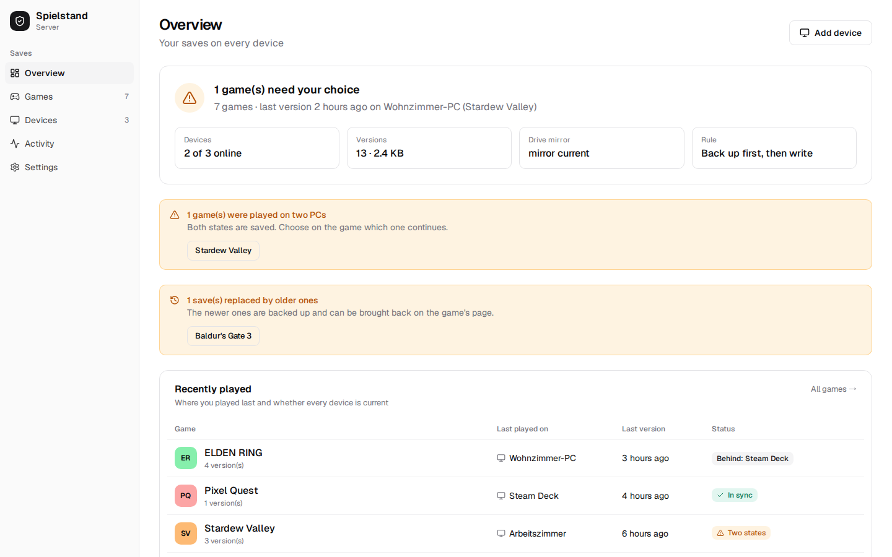
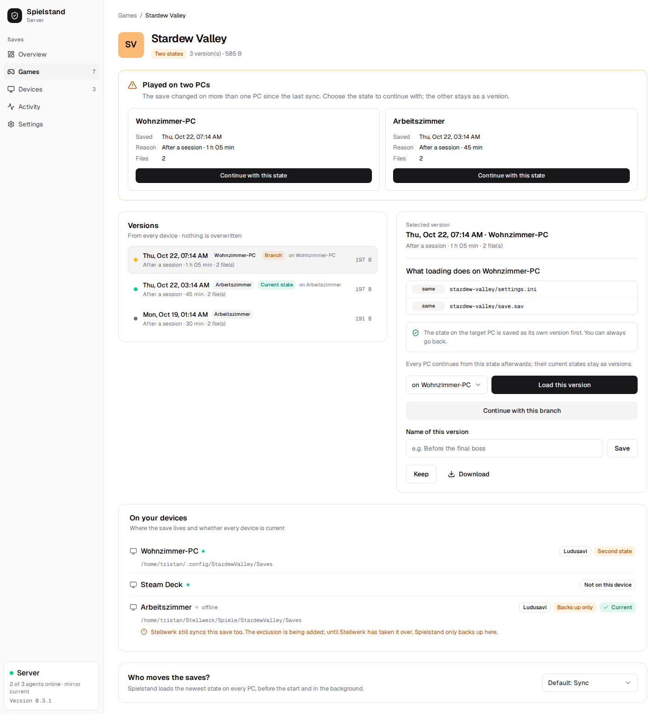
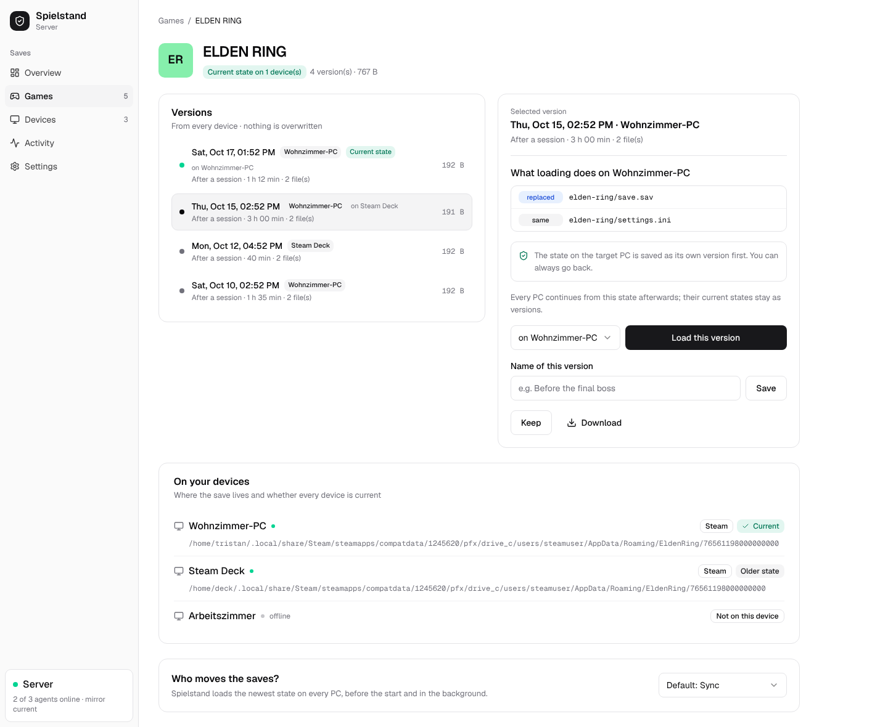
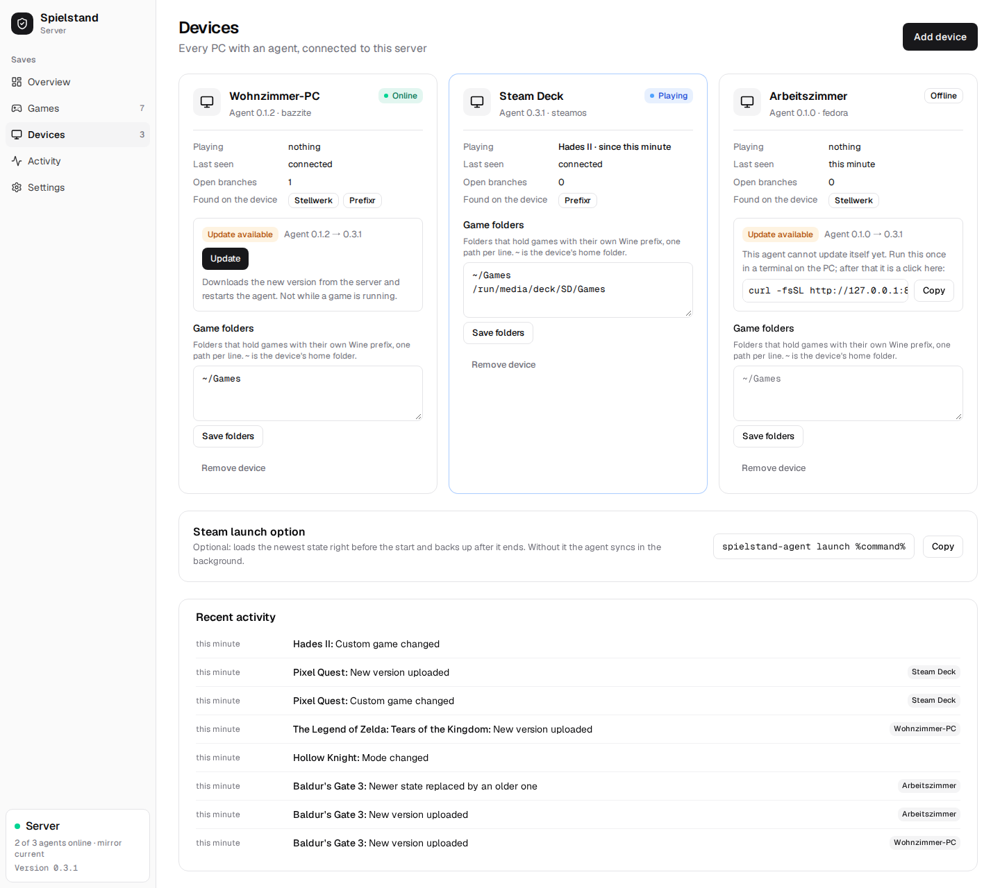
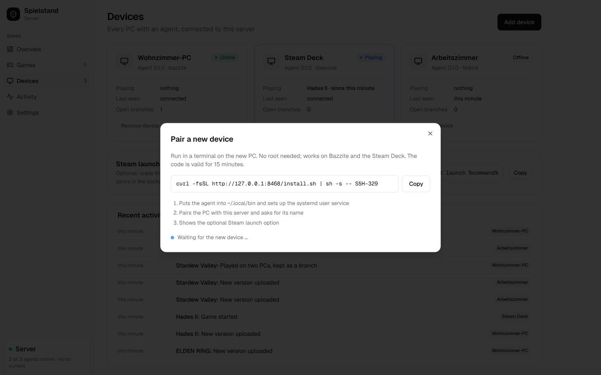
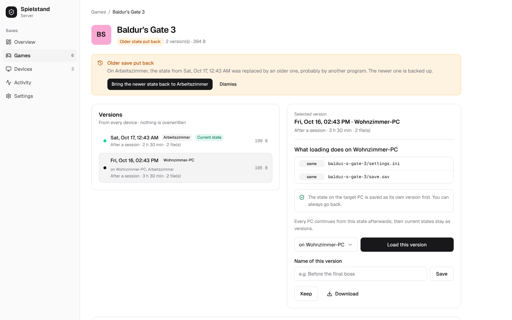

<div align="center">


<h1>Spielstand: self-hosted game save sync for Linux and the Steam Deck</h1>

**Self-hosted game save sync and backup for Linux PCs and the Steam Deck, a Ludusavi alternative with a web UI.**<br>
Keeps the saves of every game the same on all your PCs, with every version kept and nothing ever overwritten.<br>
One server on your home network, one small agent per PC, Google Drive as the offsite copy; free and open source.

[](https://github.com/firsttris/spielstand/actions/workflows/ci.yml)
[](https://github.com/firsttris/spielstand/releases/latest)
[](https://hub.docker.com/r/tristanteu/spielstand)
[](https://firsttris.github.io/spielstand/)
[](LICENSE)

```bash
docker run -d -p 8467:8467 -v spielstand:/data tristanteu/spielstand
```

[Install](#-install) •
[Features](#-features) •
[Screenshots](#-screenshots) •
[Alternatives](#-spielstand-and-the-alternatives) •
[FAQ](#-faq) •
[Documentation](https://firsttris.github.io/spielstand/)



</div>

## 💡 Why Spielstand?

Ludusavi finds and backs up saves for almost every game, but syncing between PCs means each PC
backing up to and restoring from a shared cloud folder on its own, at the right moment, without ever
restoring an older state over a newer one. Steam Cloud covers only some games, and only Steam.

- **One source of truth**: a server on your network holds every version; PCs never write to a shared
  folder and never overwrite each other.
- **No lost saves**: before anything lands on a disk, what was there becomes a version too. Two PCs
  that disagree are a conflict you resolve, never a guess by timestamp.
- **Nothing to remember**: the agent backs up after every session and brings the other PCs up to
  date; one command installs it.
- **Your old backups come along**: Ludusavi backups, also on Google Drive, become versions with
  their date and comment.

Runs on any Linux server, NAS or Raspberry Pi with Docker or Podman; the agent on Bazzite, SteamOS,
Fedora, Ubuntu, Arch and every other distribution with systemd.

## 🚀 Install

The server, with Docker Compose:

```yaml
services:
  spielstand:
    image: tristanteu/spielstand:latest
    restart: unless-stopped
    ports:
      - "8467:8467"
    volumes:
      - ./data:/data
    environment:
      SPIELSTAND_PUBLIC_URL: http://homeserver:8467
      SPIELSTAND_MIRROR: gdrive:Spielstand   # optional offsite copy through rclone
```

Open `http://homeserver:8467`, choose a password, then **Devices → Add device** and run the command
it shows on each PC, as your normal user:

```bash
curl -fsSL http://homeserver:8467/install.sh | sh -s -- K7Q-2MX
```

Updates later: after a server update, **Devices → Update** brings each PC's agent to the same version.

Podman Quadlet, Google Drive and everything else: [installation guide](https://firsttris.github.io/spielstand/installation.html).

## ✨ Features

### 🔄 Sync

- **Automatic**: backs up every change to a save within seconds, loads what another PC uploaded as
  soon as the game is not running. A new PC gets the newest state of every game it has installed.
- **Sync or back up only**, per game: let Spielstand keep the PCs in step, or only keep versions of
  each PC's saves while another tool syncs them.
- **Steam launch option**: `spielstand-agent launch %command%` loads the newest state right before a
  game starts.
- **Works offline**: versions wait on the PC and go up when the server is back.
- **Live view**: which PC plays what right now, which PCs are behind.

### 🛡️ Safety

- **Every version kept**: versions are immutable; old ones are thinned out (all for 7 days, daily
  for 90, then weekly), never the ones you marked *keep*.
- **Backup before every write**, atomic writes with verification and rollback.
- **Conflicts instead of overwrites**: played on two PCs without a sync? Both are kept, you choose.
- **Older over newer is caught**: when another program puts an older save over a newer one, the web
  UI says so and brings the newer one back with one click.
- **Plays well with others**: notices saves Syncthing still syncs and backs them up only; tells
  [Stellwerk](https://github.com/firsttris/stellwerk) which folders to leave out.
- **Tested hard**: a property-based simulation plays thousands of random histories of PCs, outages
  and restores and checks that no save state is ever lost.

### 🗂️ Versions

- **Timeline per game** with PC, play time and reason; name versions, keep them, download them.
- **Load any version on any PC** from the web UI, with a preview of which files change.
- **Finds the saves** with the Ludusavi manifest: thousands of games, Steam, Heroic, Lutris, Wine prefixes.
- **One prefix per game**: saves in each game's own Wine prefix (Prefixr,
  game folders like `~/Games`) load into the right prefix on every PC, whatever its path or user name.
- **Says why**: each game's page shows where every PC keeps the save and why one is not in step.
- **Switch emulators**: Eden, Citron, yuzu, Suyu, Sudachi and Ryujinx, one game per title, across
  emulators: play on in Ryujinx on the Deck where Eden on the desktop stopped.
- **Custom games**: add what the manifest lacks in the web UI, or let
  [Claude Code](https://claude.com/claude-code) find the saves and propose it: the agent ships a
  skill and a command line with `--dry-run` and JSON output. A proposal is only backed up on its PC
  until you take it over.

### ☁️ Backup

- **Google Drive mirror** (or any rclone remote, or a folder) of every version.
- **Rebuild a lost server** from the mirror with one command.
- **Takes over Ludusavi backups**, simple and differential, folders and ZIPs.

## 📸 Screenshots

<table>
  <tr>
    <td></td>
    <td></td>
  </tr>
  <tr>
    <td></td>
    <td></td>
  </tr>
  <tr>
    <td></td>
    <td></td>
  </tr>
</table>

## 🔀 Spielstand and the alternatives

Spielstand is made for one person or household with several Linux PCs who wants saves to follow them.

| | What it is | Where Spielstand differs |
|---|---|---|
| [Ludusavi](https://github.com/mtkennerly/ludusavi) | backup tool for game saves, with cloud upload through rclone | a server with versions decides what each PC gets; uses Ludusavi's manifest and library |
| [Steam Cloud](https://partner.steamgames.com/doc/features/cloud) | Valve's save sync for games that support it | every game, any launcher, versions you can go back to |
| [Syncthing](https://syncthing.net) | file sync between devices | knows games and running processes, keeps history, resolves conflicts per game |
| [Game Backup Monitor](https://mikemaximus.github.io/gbm-web/) | backup tool that watches games on Windows and Linux | sync between PCs with one server and a web UI |

## ❓ FAQ

### Can I sync game saves between my PC and the Steam Deck?
Yes. Install the agent on both (in desktop mode on the Deck); whatever you played last is loaded on
the other one when you start the game there. [How syncing works](https://firsttris.github.io/spielstand/how-it-works.html)

### Is there a web UI for Ludusavi backups?
Spielstand takes over Ludusavi backups, also from Google Drive, and shows them with every other
version in its web UI. [Coming from Ludusavi](https://firsttris.github.io/spielstand/ludusavi.html)

### What happens if I play offline on two PCs?
Both states are kept. The web UI shows them side by side and you pick the one to continue with; the
other stays a version.

### Does it work with Proton and non-Steam games?
Yes. Saves in Wine and Proton prefixes, Heroic and Lutris are found through the Ludusavi manifest.
When every game has its own prefix, Spielstand finds them in your game folders or in Prefixr and
loads each save into that game's prefix on every PC.

### Does it sync Switch emulator saves (Eden, Ryujinx, yuzu forks)?
Yes, without setup. Each title is its own game, and a save moves between emulators and profiles:
from Eden on one PC to Ryujinx on another.

### A game's saves are not found. What now?
Add it as a custom game: a name and the paths of its saves, in the web UI or with `spielstand-agent
custom add`. Or run `spielstand-agent skill install` and ask Claude Code on that PC to find what is
missing. [Custom games and Claude Code](https://firsttris.github.io/spielstand/custom-games.html)

### Does it run on Windows?
Not yet: the agent is for Linux. The server runs anywhere Docker runs.

## 📚 Documentation

The full documentation, with search, is at **[firsttris.github.io/spielstand](https://firsttris.github.io/spielstand/)**.

| | |
|---|---|
| [Installation](https://firsttris.github.io/spielstand/installation.html) | server with Docker or Podman, Google Drive, one command per PC |
| [How syncing works](https://firsttris.github.io/spielstand/how-it-works.html) | versions, safety rules, conflicts, retention |
| [Coming from Ludusavi](https://firsttris.github.io/spielstand/ludusavi.html) | taking over existing backups |
| [The agent](https://firsttris.github.io/spielstand/agent.html) | commands, Steam launch option, files |
| [Custom games and Claude Code](https://firsttris.github.io/spielstand/custom-games.html) | games Spielstand does not find on its own, added by hand or by an assistant |
| [Configuration](https://firsttris.github.io/spielstand/configuration.html) | every setting |
| [Backup and recovery](https://firsttris.github.io/spielstand/recovery.html) | the mirror, rebuilding a server, password reset |
| [Development](https://firsttris.github.io/spielstand/development.html) | building, checks, architecture, releases |

## 🛠️ Development

Requires Rust (stable), Node.js 24 and pnpm 12.

```bash
git clone https://github.com/firsttris/spielstand && cd spielstand
cd web && pnpm install && pnpm build && cd ..
cargo run -p spielstand-server --example demo   # demo data on :8467, password spielstand-demo
```

Rust (axum, SQLite, the Ludusavi crate) for server and agent; React 19, TanStack, Tailwind 4 and
shadcn/ui-style components for the web UI. Architecture, tests and releases: [Development](https://firsttris.github.io/spielstand/development.html).

## 🤝 Contributing

Issues and pull requests are welcome. For a bug in syncing, please add the game, `spielstand-agent
status` and the agent log (`journalctl --user -u spielstand-agent`) of the PCs involved. Please run
the [checks](https://firsttris.github.io/spielstand/development.html#checks) before opening a pull request.

---

<div align="center">

⭐ Like Spielstand? A [star on GitHub](https://github.com/firsttris/spielstand) helps others find it.<br>
🐛 [Report a bug](https://github.com/firsttris/spielstand/issues/new) · 💡 [Request a feature](https://github.com/firsttris/spielstand/issues/new)

<sub>License: <a href="LICENSE">AGPL-3.0</a> · © Tristan Teufel and contributors<br>
Changed versions you pass on or run for others must offer their source code under the AGPL; a commercial license without these obligations is available via <a href="https://teufel-it.de">teufel-it.de</a>.<br>
Spielstand is not affiliated with Ludusavi, Valve, Steam or Google.</sub>

</div>
